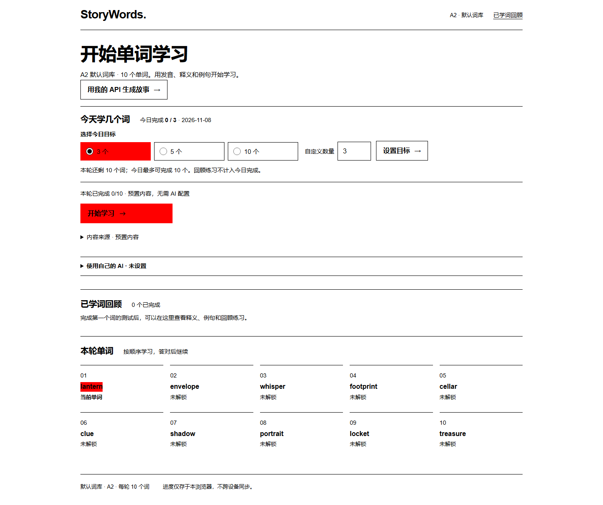

# StoryWords

**每天学几个词，你来定。Every word unlocks a story.**

StoryWords 是一个黑客松英语词汇学习 Web App：设置今日目标，用词卡认识单词、查看释义和例句，完成测试并回顾；需要语境时展开连续故事。可以选择预置内容，也可以连接自己的 AI 账号实时生成。

当前范围：**A2 · 悬疑 · 固定 10 词 · 浏览器本地存档**。不需要注册账号。

## 评审入口

- **[在线体验](https://publisher-slim-paragraph-sponsored.trycloudflare.com/)**：默认预置内容，无需 Key；“用我的 API 生成故事”可填写个人配置。这是临时隧道，依赖演示电脑持续运行，可能失效。
- **[九页 Swiss 路演](docs/pitch.html)**：[下载原始 HTML](https://raw.githubusercontent.com/lchnistarmetrostar/StoryWords/main/docs/pitch.html) 后用 Chrome/Edge 离线打开。方向键/空格翻页，F 全屏，图片内嵌，无 CDN。
- **[五分钟逐页演讲稿](docs/pitch-script.md)** · **[验证记录与边界](docs/verification.md)** · **[API 契约](docs/api-contract.md)**。
- 仓库保留的 [早期离线 Demo](docs/demo.html) 是历史预置原型，不含本轮每日目标、Swiss 界面和 BYOK；最新产品以源码为准。



GitHub 提交是源码与材料交付，**不等于永久托管网站**。临时链接失效时，可按下方步骤运行。

## 已实现的学习流程

1. 设置今日目标：3、5、10 或自定义，受真实剩余新词数限制。
2. 查看词卡、音标、中文释义和例句。英语发音使用系统语音，不可用时明确提示。
3. 按需展开故事：熟词 + 当前一个新词，后续章节带入上一章剧情。
4. 回答词义题。答错不推进，答对解锁下一词并更新今日完成数。
5. 今日达标后暂停，由用户主动决定是否继续；回顾不增加新词计数，跨本地日期重计今日进度，课程保留。
6. 完成十词后进入回顾，不生成第十一个词。刷新可恢复当前浏览器存档。

目标词：`lantern → envelope → whisper → footprint → cellar → clue → shadow → portrait → locket → treasure`。

Demo 与 AI 明确标注来源。同一轮模式固定，切换需确认，取消保留原进度。AI 失败不会自动转成 Demo。选词、测验、判题、解锁及词汇校验由程序管理；模型只生成标题与正文。

## 本地运行

需要 **Node.js 24** 和 npm，无需 `.env.local` 或站主密钥。

```bash
npm ci
npm test
npm run build
npm run typecheck
npm run start
```

打开 **http://127.0.0.1:3000**，点击“开始学习”使用预置内容；停止按 Ctrl+C。开发使用 `npm run dev`，不要与生产构建同时执行。全新下载先构建再检查类型，Next.js 需要先生成路由类型。

`npm run start` 和 `npm run dev` 使用 `scripts/start-public.cjs`：强制 BYOK-only、关闭旧站主演示模式、清空 `AI_BASE_URL` / `AI_MODEL` / `AI_API_KEY`，默认只监听本机。请沿用此入口，避免绕过保护直接运行 Next。

## 个人 API / BYOK

点击 **“用我的 API 生成故事”** → 选择 DeepSeek 或 OpenAI → 填写账号可用的模型名称与个人 Key → **“使用此配置并开始 AI 学习”**。已有预置课程会确认切换；已有 AI 当前课则继续，不重复生成。

| 供应商 | 固定官方 Chat Completions 地址 | 输出上限参数 |
| --- | --- | --- |
| DeepSeek | `https://api.deepseek.com/chat/completions` | `max_tokens: 2048` |
| OpenAI | `https://api.openai.com/v1/chat/completions` | `max_completion_tokens: 2048` |

仅支持上述协议及 JSON 对象输出，不支持自定义 Base URL、代理、Azure、Responses API 或所有模型无差别兼容。模型需支持当前协议与参数；费用由个人供应商账号承担。

密钥在当前标签页内存暂存，生成时随 HTTPS 请求发到应用服务端，再转发给官方服务。**密钥会经过应用服务端，不是浏览器直连。** 本机开发可使用回环 HTTP。密钥不写入 localStorage、sessionStorage、数据库、URL、日志或响应；刷新、离开页面或清除后需重新填写。只向你信任的网站提供密钥。

请求有字段、大小、Origin/Host 与同源检查。每个 provider+Key 最多 1 并发、滚动 60 秒最多 4 次实际供应商请求，全局最多 4 个并发生成；失败和重试计数。单次上游超时 20 秒，输出不合格最多纠正重试 1 次，输出上限 2048 tokens。不回退模型、站主配置或 Demo。

限流是单进程内计数，重启清零，**不是跨实例配额系统或累计消费上限**。

## 允许访问的来源

默认允许 `http://127.0.0.1:3000` 和 `http://localhost:3000`。公开托管时设置 `STORYWORDS_ALLOWED_ORIGINS` 为自己的精确 HTTPS 来源，多个用逗号分隔，不带路径或末尾斜杠。**不要配置站主 AI Key。** PowerShell 示例仅含非秘密配置，地址需要替换：

```powershell
$env:STORYWORDS_ALLOWED_ORIGINS = 'https://your-domain.example'
npm run start
```

页面和 API 使用同域，代理转发匹配的 Host，不开放跨域。本仓库不自动部署或建立隧道。使用其他本地端口时同步配置来源：

```powershell
$env:STORYWORDS_ALLOWED_ORIGINS = 'http://127.0.0.1:3005'
npm run start -- --port 3005
```

缺个人配置的 AI 请求返回 `503 AI_NOT_CONFIGURED`，字段/来源错误为 400，限流为 429。完整错误见 [API 契约](docs/api-contract.md)。

## 技术与目录

Next.js + React + TypeScript、简单 CSS、Node 原生测试；无数据库，无额外状态管理依赖。

| 路径 | 职责 |
| --- | --- |
| `src/app`、`src/components` | Swiss 界面、词卡、发音、每日目标、测验、回顾与个人配置 |
| `src/app/api/lesson`、`src/lib/server` | 请求验证、预置/AI、来源检查、限流、超时与安全错误 |
| `src/lib/learning.ts`、`src/data` | 固定词库、预置故事、选词、判题、解锁与词汇约束 |
| `src/lib/daily-plan.ts`、`daily-plan-storage.ts` | 本地日期、今日计数与独立存储 |
| `src/lib/byok.ts`、`src/types/contracts.ts` | 配置校验及共享类型 |
| `scripts/start-public.cjs` | 禁用站主环境密钥的分发启动入口 |
| `tests`、`docs` | 测试、正式路演、讲稿、契约与验证说明 |

## 验证与限制

- 当前产品通过 **119/119** 自动测试；发布包另加 **2 项**启动保护测试，共 **121 项**。
- 当前产品独立生产构建与 TypeScript 通过，源码与发布快照逐项核对。详见 [本次发布验证](docs/verification.md)。
- 浏览器已验证十词闭环、今日达标/主动继续、刷新/本地跨日、回顾、模式切换、390px 布局与显著 API 入口。
- BYOK 两种协议使用受控供应商响应联调；本版尚未用真实个人 Key 完成供应商验收，本次发布不调用模型。
- 此前独立本地 AI 版本真实完成过 `lantern`、`envelope` 连续生成，成功样例耗时 7.959 秒、13.646 秒；这是有限样例，不是本版 BYOK 性能基准，表达和局部一致性仍有局限。

初始熟词是预设假定，不是个人测评或权威 CEFR 词表。没有无限词库、账号、跨设备同步、复杂间隔复习或学习效果实证。进度属于当前浏览器及网址；建议一轮只开一个标签页，避免旧页覆盖进度。发音依赖系统英语语音，手机真机及其他浏览器仍需检查。

## 研究依据

- [CHI 2024：Putting Things into Context](https://www.media.mit.edu/publications/putting-things-into-context/)：272 人研究支持个性化语境对学习动机的积极作用，没有观察到组间学习表现差异。
- [EMNLP 2025：SRS-Stories](https://aclanthology.org/2025.emnlp-industry.44/)：研究词汇约束生成与文本质量，不是长期记忆效果验证。

这些是设计启发，不能当作 StoryWords 已提升学习效果的证据。

## 发布范围

只发布明确选定的源码、依赖锁、配置、测试与对外材料，不含 `references/`、现有 `.env` 文件、真实密钥、访问码、私人记录、Agent 对话、日志、浏览器存档和构建产物。字体许可随字体保留；产品图片来自实际浏览器，未伪造界面。
